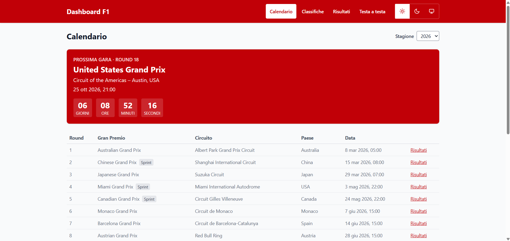
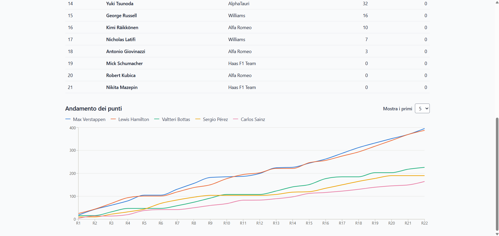
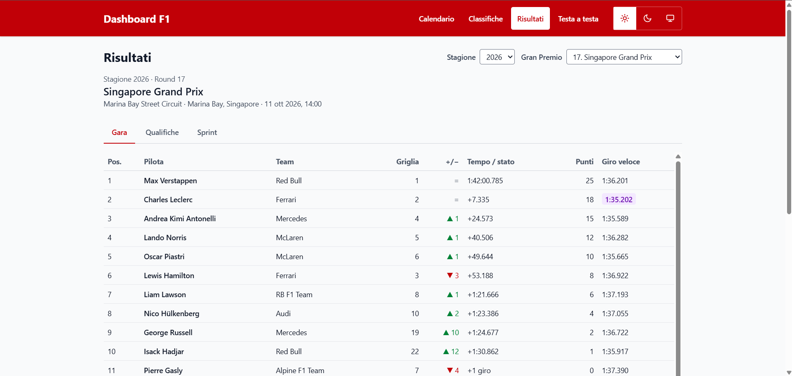
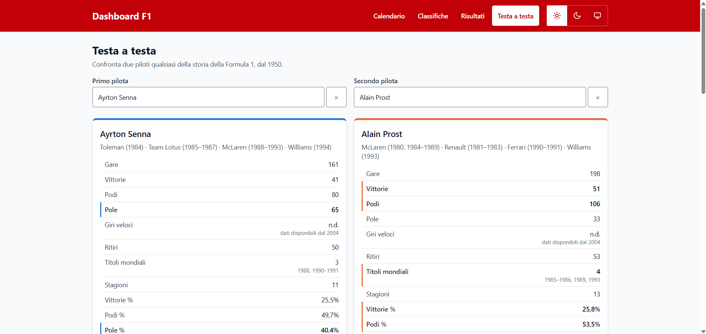
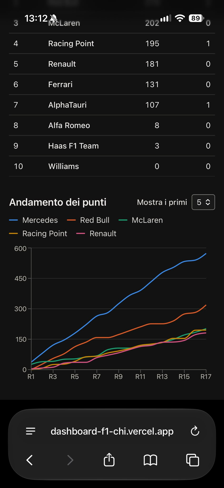

# Dashboard F1

> **Come è nato questo progetto**
>
> È il mio primo progetto realizzato insieme a un'intelligenza artificiale.
> Il codice è stato scritto da Claude Code (Anthropic); il mio ruolo è stato
> definire cosa costruire, scegliere tra le soluzioni proposte, approvare
> ogni piano prima dell'esecuzione e verificare ogni fase nel browser.
> Il percorso completo, con le decisioni prese fase per fase, è in [PIANO.md](PIANO.md).

Dashboard web di Formula 1 con calendario, classifiche, risultati e un confronto testa a testa tra due piloti qualsiasi della storia, dal 1950 a oggi.

**App online:** [dashboard-f1-chi.vercel.app](https://dashboard-f1-chi.vercel.app/calendario)

> Progetto non ufficiale, non affiliato con Formula 1. Dati forniti da [Jolpica F1 API](https://github.com/jolpica/jolpica-f1).



| Classifiche | Risultati |
|---|---|
|  |  |

| Testa a testa | Telefono, tema scuro |
|---|---|
|  |  |

## Sezioni

- **Calendario**: gare della stagione con la prossima gara e il conto alla rovescia; link ai risultati delle gare già corse. Tutte le stagioni dal 1950.
- **Classifiche**: piloti e costruttori (dal 1958) di qualsiasi stagione, con il grafico dell'andamento dei punti gara per gara costruito dalle classifiche ufficiali dopo ogni round.
- **Risultati**: gara, qualifiche e sprint di ogni Gran Premio, con griglia, posizioni guadagnate o perse, distacchi e giro veloce; navigazione tra GP precedente e successivo.
- **Testa a testa**: confronto tra due piloti su vittorie, podi, pole, titoli e percentuali per gara, posizione in campionato per anno di carriera e, se hanno corso insieme, chi è arrivato davanti all'altro (anche da compagni di squadra).

Altre caratteristiche: tema chiaro, scuro o di sistema; utilizzabile da telefono (da 360px); navigazione completa da tastiera; animazioni brevi che rispettano l'impostazione "riduci movimento".

## Note sui dati

- Il sistema di punteggio della F1 è cambiato molte volte, quindi **i punti di piloti di epoche diverse non sono confrontabili**: il testa a testa si basa su vittorie, podi, pole, titoli e percentuali.
- I dati delle epoche più vecchie sono incompleti: le qualifiche ci sono dal 1994 (prima si usa la griglia di partenza) e i giri veloci dal 2004.
- L'API pubblica Jolpica ha limiti di 4 richieste al secondo e 500 all'ora. L'app mette in coda le richieste e salva le risposte nel browser (IndexedDB): le stagioni concluse restano in cache per sempre, quella in corso viene aggiornata ogni poche ore. Il primo caricamento della carriera di un pilota può richiedere qualche secondo.

## Tecnologie

React, TypeScript e Vite · Tailwind CSS · React Router · TanStack Query · Recharts · Motion · Vitest e Testing Library.

App solo frontend: nessun backend, i dati arrivano direttamente dall'API pubblica.

## Avvio in locale

Serve Node.js 22.12 o successivo.

```bash
npm ci          # installa le dipendenze
npm run dev     # server di sviluppo su http://localhost:5173
npm test        # test (l'API è sempre simulata, nessuna chiamata reale)
npm run lint    # ESLint
npm run build   # build di produzione in dist/
npm run preview # anteprima della build
```

## Struttura

```
src/
  api/         client Jolpica: coda delle richieste, paginazione, cache
  types/       tipi TypeScript delle risposte API
  hooks/       hook TanStack Query
  lib/         logica pura (statistiche, trasformazioni per i grafici), con test
  components/  componenti riutilizzabili
  pages/       una pagina per sezione
```

Il piano di sviluppo con le scelte fatte in ogni fase è in [PIANO.md](PIANO.md).

## Pubblicazione

L'app è pubblicata su Vercel ([dashboard-f1-chi.vercel.app](https://dashboard-f1-chi.vercel.app/calendario)) e si aggiorna a ogni push su `main`. `vercel.json` rimanda tutte le rotte a `index.html`, così gli indirizzi come `/risultati/2025/1` funzionano anche aprendoli direttamente.

## Licenza

[MIT](LICENSE). I dati appartengono ai rispettivi proprietari e sono forniti da Jolpica F1 API.
